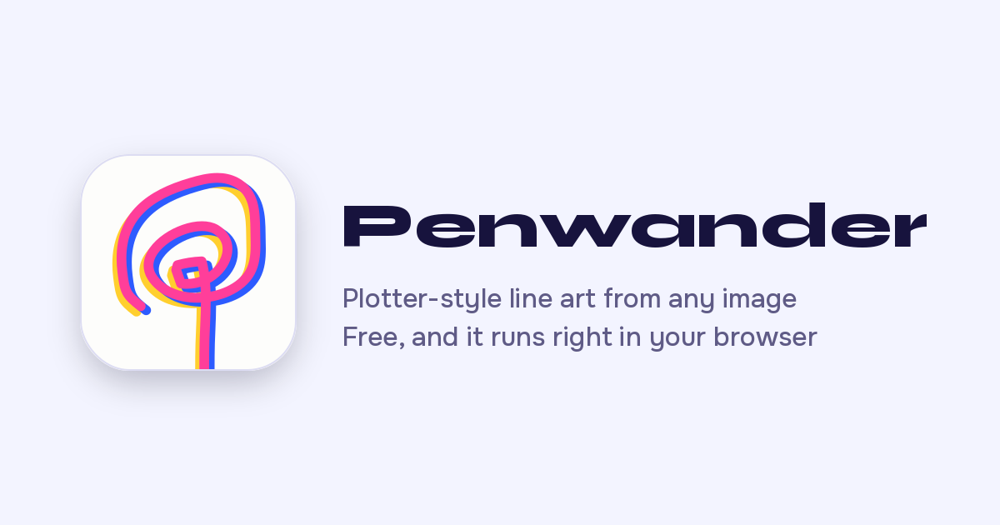

# Penwander

Turn any image into a plotter-style line drawing, or trace it by hand.

**Live site:** https://penwander.github.io/

## What it does

- **Generate:** traces an image as one continuous line or as separate strokes, the way a pen plotter would draw it. Presets with **Random** (any starting point) and **New seed** (a new variation of the current one), tone controls (brightness, contrast, gamma, edge emphasis), line controls (length, definition, smoothing, wobble, seed) and a three-pen cyan/magenta/yellow mode.
- **Crop:** with Fill frame, choose which part of the image fills the sheet using zoom and position sliders, or drag the image on the sheet.
- **Trace & draw:** a blank sheet with your image as a faint guide. Draw with a pen, paint with a line brush that uses the same algorithm, erase, undo and redo.
- **Paper texture:** dots, lines, grid, canvas or grain, with adjustable spacing and strength. Shown on screen and in PNG and PDF exports, left out of the SVG so a plotter won't draw it.
- **Real paper sizes:** A4, A3, Letter and custom widths in millimetres, with pen tip sizes in mm and an estimated plot time.
- **Dust:** a separate page that redraws an uploaded picture in dust and saves it as a PNG up to 3200 px. Six looks (dust on black, soot on paper, gold dust, chalk, rust on sand, colour dust) with custom dust and surface colours, glow and surface texture; grain amount, size, shape (round, mixed, flakes), clumps and sparkle; patchiness, scatter, stray grains, haze, edge fade and margin; contrast, brightness, detail and invert; wind with strength and gustiness. **New variation** picks a random look and settings; **Settle again** replays the dust settling over three seconds.
- **Export:** PNG (up to 4800 px), SVG sized in millimetres with one path per pen (ready for a plotter), and a vector PDF that prints at actual size.

Everything runs in the browser. Images are never uploaded anywhere.

## Files

| File | Purpose |
|---|---|
| `index.html` | The whole app: markup, styles and script in one file |
| `dust.html` | The Dust page: redraws a picture in dust and saves it as a PNG |
| `favicon.svg` | Browser-tab icon |
| `apple-touch-icon.png`, `icon-512.png` | Home-screen icons |
| `og-image.png` | Preview image shown when the link is shared |
| `terms.html`, `privacy.html` | Terms & Conditions and Privacy Policy pages |

No build step. Edit `index.html` and commit; GitHub Pages redeploys automatically.

## Credits

Inspired by [PINTR](https://javier.xyz/pintr) by javierbyte.
